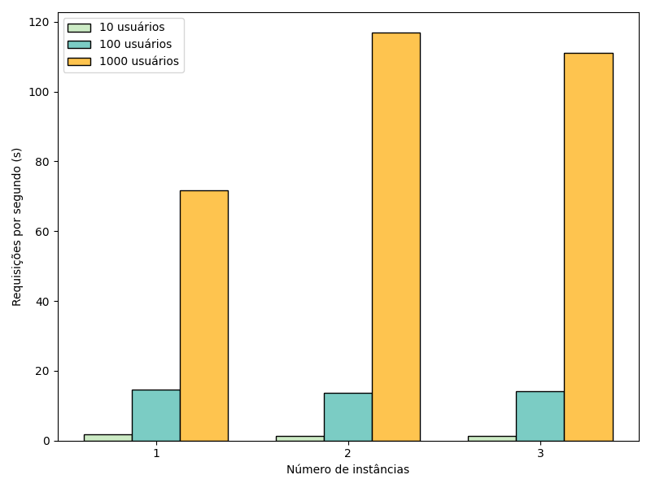
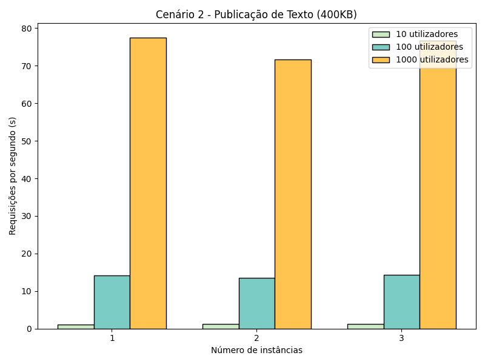
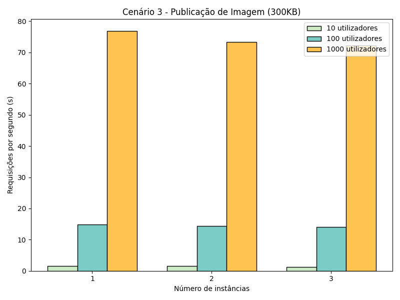

# Computação Distribuída - Configuração do WordPress com Múltiplas Instâncias

Este repositório contém a entrega do Trabalho 2 e do Trabalho 3, que têm como objetivo executar múltiplas instâncias do WordPress utilizando o Nginx como balanceador de carga, o Docker Compose para orquestração dos contêineres e o Locust para avaliação de desempenho sob estresse.

## Arquitetura (Trabalho 2)
A infraestrutura é composta por 5 contêineres:
-   1x Nginx (Balanceador de carga recebendo tráfego na porta 80).
-   3x WordPress (Instâncias da aplicação partilhando o volume `/var/www/html`).
-   1x MySQL (Banco de dados isolado na rede backend).

## Evidências e Análise de Funcionamento

### 1. Inicialização da Infraestrutura
Através do terminal, o comando `docker-compose up -d` foi executado para baixar as imagens e iniciar os serviços. A interface do Docker Desktop confirmou que os contêineres foram criados e encontram-se em execução estável.

### 2. Teste de Balanceamento via Terminal (CLI)
Para verificar a distribuição de carga pelo Nginx, foi executado o comando `curl.exe -I http://localhost/` múltiplas vezes consecutivas. 
A análise dos cabeçalhos HTTP devolvidos comprova o sucesso do balanceamento, uma vez que a variável `X-Upstream` alternou os endereços IP de resposta, encaminhando as requisições de forma circular para os três contêineres do WordPress:
-   Resposta 1: `X-Upstream: 172.18.0.2:80`
-   Resposta 2: `X-Upstream: 172.18.0.3:80`
-   Resposta 3: `X-Upstream: 172.18.0.4:80`

### 3. Acesso e Teste via Navegador (Web)
O acesso via browser ao endereço `http://localhost/` redirecionou corretamente para a página de instalação do WordPress (`install.php`).
Utilizando as ferramentas de desenvolvedor do navegador (DevTools > Network), a inspeção dos pacotes de rede confirmou o mesmo comportamento observado no terminal: ao recarregar a página, os "Cabeçalhos de Resposta" (Response Headers) do documento principal exibem o IP do contêiner a alterar dinamicamente na propriedade `X-Upstream` (ex: alternando entre `172.18.0.3:80` e `172.18.0.2:80`).

Isto atesta que o Nginx está configurado corretamente como proxy reverso e a balancear a carga entre as instâncias da aplicação.

---

## Avaliação de Desempenho e Balanceamento de Carga (Trabalho 3)

Esta etapa expande a arquitetura para analisar o comportamento do sistema sob estresse, utilizando a ferramenta Locust para simular tráfego concorrente e medir a Vazão (Requisições por Segundo - RPS) em diferentes configurações de infraestrutura.

### Metodologia
Os testes de carga foram aplicados contra o Nginx (`http://localhost`), que distribuiu as requisições entre os contêineres do WordPress. Foram avaliados três cenários de peso de página distintos com cargas progressivas de 10, 100 e 1000 usuários simultâneos, cruzando com a disponibilidade da infraestrutura (reduzindo de 3 para 2 e 1 instância ativa do WordPress manualmente via `docker stop`).

### Cenário 1: Publicação com Imagem de 1MB (Pesado)
Simulação de requisições a uma página exigindo maior transferência de dados e tempo de renderização.

| Instâncias | 10 Usuários | 100 Usuários | 1000 Usuários |
| :--- | :--- | :--- | :--- |
| 1 Instância | 1.7 RPS | 14.6 RPS | 71.6 RPS |
| 2 Instâncias | 1.3 RPS | 13.6 RPS | 116.9 RPS |
| 3 Instâncias | 1.4 RPS | 14.2 RPS | 111.2 RPS |

**Análise:** O aumento de instâncias de 1 para 2 gerou um ganho expressivo na vazão para cargas pesadas (pico de 1000 usuários), saltando de 71.6 para 116.9 RPS. No entanto, a terceira instância não trouxe escalabilidade linear, estabilizando na faixa dos 111 RPS. Isso sugere que, a partir de certo ponto de requisições pesadas simultâneas, o gargalo se desloca da capacidade de processamento do servidor web para o banco de dados MySQL centralizado ou para o limite de I/O do sistema anfitrião.

### Cenário 2: Publicação de Texto de 400KB (Leve)
Simulação de requisições a uma página leve baseada unicamente em texto estático.

| Instâncias | 10 Usuários | 100 Usuários | 1000 Usuários |
| :--- | :--- | :--- | :--- |
| 1 Instância | 1.1 RPS | 14.2 RPS | 77.5 RPS |
| 2 Instâncias | 1.3 RPS | 13.6 RPS | 71.7 RPS |
| 3 Instâncias | 1.3 RPS | 14.3 RPS | 76.6 RPS |

**Análise:** O processamento de páginas leves apresentou uma vazão altamente nivelada. O sistema atingiu uma média de ~75 RPS sob carga máxima independentemente do número de instâncias. Isso indica que, para este tipo de resposta leve, uma única instância é perfeitamente capaz de lidar com a carga, e a adição de contêineres extras não proporciona ganhos de requisições por segundo.

### Cenário 3: Publicação com Imagem de 300KB (Intermediário)
Simulação de requisições a uma página de peso intermediário.

| Instâncias | 10 Usuários | 100 Usuários | 1000 Usuários |
| :--- | :--- | :--- | :--- |
| 1 Instância | 1.5 RPS | 14.9 RPS | 76.9 RPS |
| 2 Instâncias | 1.5 RPS | 14.3 RPS | 73.3 RPS |
| 3 Instâncias | 1.3 RPS | 14.1 RPS | 72.3 RPS |

**Análise:** O comportamento assemelhou-se estritamente ao do cenário de texto. O sistema travou seu processamento na faixa dos 72-76 RPS no pico máximo. Como a resposta em bytes diminuiu significativamente em relação ao Cenário 1, a adição de instâncias de processamento não melhorou o rendimento, demonstrando que o balanceamento traz vantagens expressivas primariamente em operações que saturam as instâncias web isoladas (como imagens massivas de 1MB).